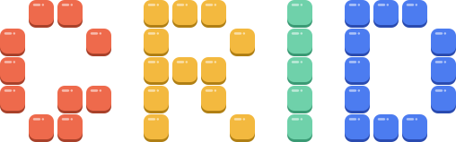

# Grid



Block puzzle game: place pieces from a tray of three onto an 8x8 board and clear full rows and columns.

## Dependencies

- C++20 compiler
- CMake 3.20 or newer
- SDL3
- SDL3_ttf

## Build

```
cmake -S . -B build
cmake --build build
ctest --test-dir build
./build/grid
```

## Android

Requires the Android SDK, NDK 28.2.13676358, CMake 3.22.1 from the SDK, JDK 21 and Gradle 8.13 (the Android Gradle plugin used here does not work with Gradle 9.6 or newer). The SDL3 and SDL3_ttf source trees are built with the app. SDL3_ttf needs its `external` submodules checked out.

```
export ANDROID_HOME=/path/to/sdk
export SDL3_SOURCE_DIR=/path/to/SDL3
export SDL3_TTF_SOURCE_DIR=/path/to/SDL3_ttf
gradle -p android assembleDebug
```

The APK is written to `android/app/build/outputs/apk/debug`. Use `-Pgrid.abis=arm64-v8a` to build a single ABI. The default is arm64-v8a, armeabi-v7a and x86_64. Release signing is not configured.

## License

GPL-3.0-only. The bundled Geologica font is licensed under the SIL Open Font License 1.1, see assets/OFL.txt.
